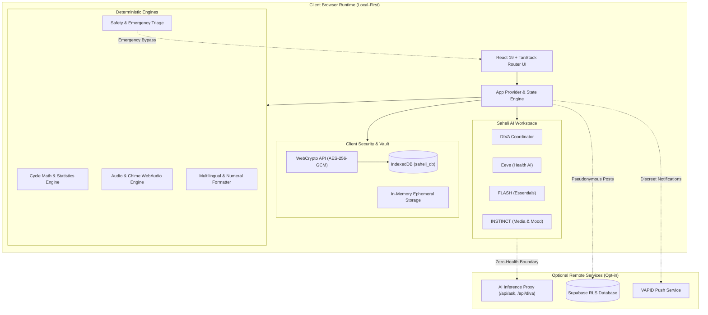

# Saheli — Privacy-First Menstrual Health & Cycle Companion

[](https://github.com/nafisdevtale/remix-of-saheli-cycle-companion)
[](https://opensource.org/licenses/MIT)
[](https://github.com/nafisdevtale/remix-of-saheli-cycle-companion)
[](https://github.com/nafisdevtale/remix-of-saheli-cycle-companion)

Saheli (सहेली / सखी) is an evidence-informed, local-first menstrual cycle companion and progressive web application engineered specifically for individuals and families across India. Combining client-side cryptographic security, authentic multilingual localization across **English, Hindi (हिन्दी), and Marathi (मराठी)**, an adaptable AI workspace, and deterministic clinical triage, Saheli empowers users with deep bodily literacy while guaranteeing zero third-party surveillance.

---

## Table of Contents

1. [Core Values & Mission](#1-core-values--mission)
2. [Architecture Overview](#2-architecture-overview)
3. [Local-First Privacy & Encryption Architecture](#3-local-first-privacy--encryption-architecture)
4. [Multilingual Framework & Native Numerals](#4-multilingual-framework--native-numerals)
5. [Menstrual Cycle Engine & Tracking Accuracy](#5-menstrual-cycle-engine--tracking-accuracy)
6. [Expert Insights & Analytics](#6-expert-insights--analytics)
7. [Educational Sanctuary & Health Literacy](#7-educational-sanctuary--health-literacy)
8. [Saheli AI Workspace & Multi-Agent Orchestration](#8-saheli-ai-workspace--multi-agent-orchestration)
9. [Community & Pseudonymous Peer Support](#9-community--pseudonymous-peer-support)
10. [Partner Connect & Cryptographic Sharing](#10-partner-connect--cryptographic-sharing)
11. [Discreet Mode & Physical Safety Controls](#11-discreet-mode--physical-safety-controls)
12. [App Lock, Recovery & Vault Security](#12-app-lock-recovery--vault-security)
13. [Data Portability: Import, Export & Backup](#13-data-portability-import-export--backup)
14. [Audio Controller: Chimes & Speech Synthesis](#14-audio-controller-chimes--speech-synthesis)
15. [Progressive Web App (PWA) & Offline Reliability](#15-progressive-web-app-pwa--offline-reliability)
16. [Evidence Base & Medical Safeguards](#16-evidence-base--medical-safeguards)
17. [Regulatory Compliance & Adolescent Safeguards](#17-regulatory-compliance--adolescent-safeguards)
18. [Navigation & Information Architecture](#18-navigation--information-architecture)
19. [Technical Stack & Dependencies](#19-technical-stack--dependencies)
20. [Getting Started, Development & Quality Gates](#20-getting-started-development--quality-gates)
21. [License, Governance & Disclaimers](#21-license-governance--disclaimers)

---

## 1. Core Values & Mission

- **Privacy as a Fundamental Right**: Your menstrual cycle, symptoms, sexual health, and personal notes belong to you alone. Saheli stores records locally on your device with optional AES-GCM encryption. No account creation, email, or phone number is ever required.
- **Dignity & Accessibility**: Menstrual health education must be respectful, clear, and available in native Indian languages. Saheli supports English, Hindi, and Marathi with 100% key parity and native Indic numerals.
- **Physical Safety on Shared Phones**: In multi-generational households where phones are frequently shared, Saheli provides Discreet Mode ("Personal Diary"), a fast panic lock, and a PIN/passphrase vault.
- **Honest Algorithmic Boundaries**: Cycle predictions are displayed as cautious probability intervals rather than deceptive single-day guarantees. Fertility predictions are strictly suppressed for adolescents (under 18) and irregular cycles.

---

## 2. Architecture Overview

Saheli operates on an offline-first, client-authoritative architecture where all health calculations and diary mutations run in the browser runtime.



---

## 3. Local-First Privacy & Encryption Architecture

- **IndexedDB Storage**: Health diary entries, observations, and configuration preferences live in client-side IndexedDB (`saheli_db`).
- **WebCrypto AES-256-GCM Vault**:
  - Keys are derived client-side via PBKDF2 (100,000 iterations, SHA-256) from user PINs or passphrases.
  - Data at rest is encrypted with standard 12-byte initialization vectors (IV) and 128-bit authentication tags.
  - If a device is locked, encrypted records cannot be read by any script or inspector without the secret.
- **Zero Third-Party Trackers**: Zero Google Analytics, zero Meta Pixels, zero advertising SDKs. Network traffic occurs only when explicit user actions request remote services (e.g., Community posts or AI inquiries).

---

## 4. Multilingual Framework & Native Numerals

Saheli supports exactly three core languages, audited for 100% key parity (2,156 verified keys each):

1. **English (`en`)**: Baseline international terminology.
2. **Hindi (`hi`)**: Natural Devanagari script vernacular with authentic medical terminology.
3. **Marathi (`mr`)**: Regionally adapted Devanagari vocabulary tailored for Maharashtra.

### Indic Numbering & Native Script Numerals
- By default, non-English languages render numbers in native Devanagari script (e.g., `२८` for `28`, `१२,३४,५६७` for `12,34,567`).
- Users can toggle between native Indic numerals and standard Latin digits in **Settings → Display Preferences**.
- Backward-compatible automatic migration: Users previously configured with discontinued regional languages are gracefully migrated to English with an informative in-app notice.

---

## 5. Menstrual Cycle Engine & Tracking Accuracy

The Saheli menstrual tracking engine follows strict clinical rules:

- **Calendar-Day Calculation**: Cycle length is calculated strictly as the calendar-day difference between consecutive confirmed period starts:
  $$\text{Cycle Length} = \text{Date}(\text{Period Start}_{i+1}) - \text{Date}(\text{Period Start}_i)$$
- **Bleeding Episode Duration**: Period length is measured as the continuous calendar days of menstrual bleeding, tolerating up to a 1-day unlogged gap within an active episode.
- **Spotting vs. Confirmed Start**: Isolated single-day spotting mid-cycle is cataloged separately and never resets the cycle start date.
- **Robust Statistics**: Median cycle lengths and interquartile ranges (IQR) are calculated on validated history windows (last 6 completed cycles).
- **Leap Year & Timezone Resilience**: Handled strictly via UTC calendar date arithmetic (`YYYY-MM-DD`), preventing daylight-saving or timezone rollover corruption.

---

## 6. Expert Insights & Analytics

Saheli 11.9 structures clinical and statistical feedback into five distinct sections:

1. **Cycle Overview**: Completed cycle counts, median cycle length, range (min–max), and cycle variability.
2. **Period Overview**: Median bleeding duration, duration range, and bleeding volume distribution (spotting, light, medium, heavy).
3. **Symptoms & Well-being**: Multi-cycle recurring patterns, phase correlation (follicular, luteal, premenstrual), average pain scores (/10), disruptive pain frequency, and sleep averages.
4. **Patterns Over Time**: Historical bar charts, Recent 6 vs. All cycles toggle, next predicted window, and complete cycle comparison tables.
5. **When to Seek Professional Guidance**: Evidence-informed clinical thresholds (cycles $<21$ or $>35$ days, variation $>7$ days, bleeding $>7$ days, heavy soaking $>1-2$ hours).

---

## 7. Educational Sanctuary & Health Literacy

- **Evidence-Based Medical Lessons**: Comprehensive guides on cycle phases, PCOS/PCOD, endometriosis, contraception realities, perimenopause, and thyroid health.
- **Interactive Symptom Glossary**: Explanations for over 30 physical and emotional symptoms.
- **Doctor Preparation Guide (`/visit`)**: Formats current cycle history into an exportable, non-identifying consultation summary.

---

## 8. Saheli AI Workspace & Multi-Agent Orchestration

The Saheli AI Workspace coordinates specialized assistants under unified privacy firewalls:

- **DIVA (Central Coordinator)**: Directs user prompts to the appropriate specialist or synthesizes multi-agent responses.
- **Eeve (Health AI Companion)**: Evidence-based clinical cycle education and triage.
- **FLASH (Essentials Advisor)**: Recommends curated menstrual products, reusable cups, and comfort essentials.
- **INSTINCT (Entertainment & Relaxation)**: Suggests feel-good cinema, soothing music, and literature matched to mood.
- **Customizable Drag-and-Drop Layout**: Specialist cards feature pointer/touch dragging, accessible keyboard Move Up/Down controls, persistent ordering in `localStorage`, and one-click layout resets.

---

## 9. Community & Pseudonymous Peer Support

- **Zero-PII Pseudonymity**: Posts and replies are tied to an ephemeral cryptographic token hash (`Saheli 4821`).
- **Supabase Row-Level Security (RLS)**: Public tables enforce strict client-side read/write boundaries with pre-publication moderation status.
- **Automatic Content Filtering**: Client and server filters redact phone numbers, email addresses, and external URLs before storage.
- **One-Click Instant Purge**: "Delete All My Data" completely purges every post and reply associated with the device hash.

---

## 10. Partner Connect & Cryptographic Sharing

- **Cycle Owner & Partner Roles**: Configurable on first launch or via settings.
- **Encrypted Synchronization**: Direct asymmetric pairing allowing partners to view cycle phases, supportive tips, and comfort suggestions without exposing intimate notes.
- **Partner View**: Tailored dashboard displaying cycle phase status, helpful reminders, and mood support guidelines.

---

## 11. Discreet Mode & Physical Safety Controls

- **Discreet Alias**: Toggling Discreet Mode transforms Saheli into a generic "Personal Diary" with neutral themes and subtle floral branding.
- **Discreet Notifications**: Push notifications display neutral text ("Time for your daily reflection") rather than menstrual reminders.
- **Panic Exit**: Quick-close actions clear active in-memory session states immediately.

---

## 12. App Lock, Recovery & Vault Security

- **Multi-Factor Vault Options**: Support for 4-to-12 digit PINs or arbitrary alphanumeric passphrases.
- **Brute-Force Lockout**: Consecutive invalid attempts trigger progressive exponential backoff delays.
- **Recovery Phrase Verification**: Deterministic recovery keys permit cryptographic vault recovery without central key escrows.

---

## 13. Data Portability: Import, Export & Backup

- **JSON Full-Vault Backup**: Encrypted or plaintext export of full diary records, observations, companion states, and custom settings.
- **CSV Spreadsheets**: Clean, spreadsheet-friendly exports for review in Excel or sharing with healthcare providers.
- **Strict Validation on Import**: Imported archives undergo structural sanity checks and schema version migrations before merging into IndexedDB.

---

## 14. Audio Controller: Chimes & Speech Synthesis

- **WebAudio Saheli Chime**: Synthesized calming frequencies (432 Hz / 528 Hz gentle bell chimes) generated via pure Web Audio oscillators without heavy external MP3 downloads.
- **Read Aloud (TTS)**: Built-in speech synthesis engine supporting natural narration in English, Hindi, and Marathi.

---

## 15. Progressive Web App (PWA) & Offline Reliability

- **Service Worker (`public/sw.js`)**: Static caching strategy that caches only same-origin build assets (`/assets/*`).
- **Zero Cache on Health Data**: Health records and database interactions are excluded from Service Worker caches.
- **Installable Desktop & Mobile App**: Compliant W3C web manifest with standalone display support and responsive layout adaptations.

---

## 16. Evidence Base & Medical Safeguards

Saheli's clinical algorithms, educational lessons, and symptom thresholds reference established peer-reviewed protocols:
- **National Health Service (NHS)**: Period health & adolescent cycle guidelines.
- **American College of Obstetricians and Gynecologists (ACOG)**: Menstruation in adolescents and cycle length definitions.
- **World Health Organization (WHO)**: Reproductive health and anemia intervention recommendations.
- **Federation of Obstetric and Gynaecological Societies of India (FOGSI)**: Clinical guidance adapted for Indian demographic contexts.
- **Ministry of Health and Family Welfare (MoHFW)**: Rashtriya Kishor Swasthya Karyakram (RKSK) adolescent standards.

---

## 17. Regulatory Compliance & Adolescent Safeguards

- **Digital Personal Data Protection (DPDP) Act 2023 (India)**: Strictly follows data minimization principles. Personal records remain on the data principal's hardware.
- **Adolescent Safeguards (Under 18)**:
  - Fertility windows and ovulation estimates are **strictly suppressed**.
  - Cycle variation tolerance is widened to 21–45 days per clinical guidance.
  - Educational guidance emphasizes that irregularity in the first 2–3 post-menarche years is normal.
- **Non-Medical Certification Disclaimer**: Saheli is an educational self-care companion and does not constitute certified medical diagnosis, treatment, or contraceptive device software.

---

## 18. Navigation & Information Architecture

Saheli organizes navigation into five clear categories:

1. **Daily**: Today (`/`), Calendar (`/calendar`), Log (`/log`).
2. **Understand**: Insights (`/insights`), Learn (`/learn`), Doctor Guidance (`/doctor`).
3. **Explore**: Self Care (`/selfcare`), Discover (`/discover`), AI Workspace (`/diva`).
4. **Connect**: Community (`/community`), Partner Connect (`/partner`).
5. **Manage**: Settings (`/settings`), Help & Feedback (`/feedback`).

---

## 19. Technical Stack & Dependencies

- **Frontend Core**: React 19, TypeScript, Vite 6, Tailwind CSS v4.
- **Routing**: TanStack Router (file-based routing under `src/routes`).
- **Icons & Visuals**: Lucide React, Custom SVG motifs.
- **Data Persistence**: IndexedDB (native `idb` wrappers), WebCrypto API.
- **Testing**: Vitest, React Testing Library, JSDOM.
- **Formatting & Linters**: Prettier, ESLint 9.

---

## 20. Getting Started, Development & Quality Gates

### Prerequisites
- [Bun](https://bun.sh/) (preferred) or [Node.js](https://nodejs.org/) v20+.

### Installation & Local Development

```bash
# Clone the repository
git clone https://github.com/nafisdevtale/remix-of-saheli-cycle-companion.git
cd remix-of-saheli-cycle-companion

# Install dependencies
bun install

# Start local development server
bun run dev
```

### Automated Quality Gates

```bash
# Run full automated test suite (620+ tests)
bun run test

# Check i18n key parity across en, hi, mr
bun run i18n:check

# Run ESLint code checks
bun run lint

# Build production bundle
bun run build
```

---

## 21. License, Governance & Disclaimers

### Open Source License
Saheli Cycle Companion is distributed under the permissive **MIT License**.

### Emergency Helplines (India)
- **National Emergency Number**: `112`
- **Ambulance Services**: `108`
- **Tele-MANAS Mental Health Support**: `14416` / `1800-891-4416`
- **KIRAN Mental Health Helpline**: `1800-599-0019`
- **Women Helpline**: `1091` / `181`

---
*Saheli — Empowering bodily autonomy, local privacy, and clinical understanding across India.*
