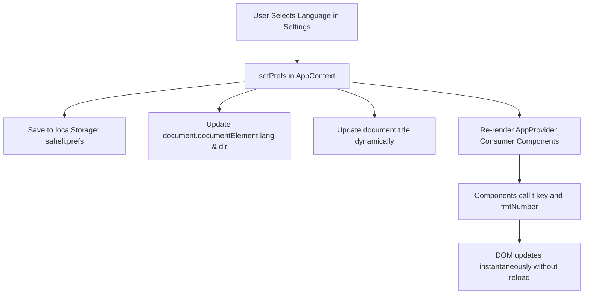

# Saheli 10.5 — Locale Architecture & Internationalization Technical Specification

## 1. Architectural Philosophy

Saheli is a local-first menstrual cycle tracking and reproductive health companion designed for privacy on shared family phones in India. The localisation system adheres to five core architectural tenets:

1. **Zero External Translation Dependencies at Runtime**: All dictionary strings are bundled locally; switching languages never makes remote network calls or leaks user activity.
2. **Standard-Based Formatting (CLDR / `Intl`)**: Numbers, percentages, currency, dates, times, and lists are formatted using official Unicode Common Locale Data Repository (CLDR) rules via ECMAScript Internationalization APIs (`Intl`).
3. **Dual Numbering System Architecture**: Standard Latin digits (`0-9`) remain the default across all languages for maximum clinical readability, while native regional Indic numerals (Devanagari, Bengali, Gujarati, Gurmukhi, Odia, Tamil, Telugu, Kannada, Malayalam, Arabic-Indic) are available via an opt-in toggle in Settings (`prefs.nativeNumerals`).
4. **Instant Reactive Switching**: Language updates propagate through React Context (`<AppProvider>`), immediately updating UI elements, document titles, `<html lang="...">`, and `<html dir="rtl|ltr">` without reloading the page or losing form state.
5. **Strict Medical & Safeguard Parity**: All clinical thresholds, red-flag triage rules, and adolescent privacy protections (under-18 restrictions) execute identically regardless of the selected language.

---

## 2. Module Blueprint: `src/lib/locale.js`

The central formatting engine resides in `src/lib/locale.js`. It caches `Intl` formatter instances to prevent memory thrashing during rapid re-renders.

### 2.1 BCP 47 Locale Tag Mapping

```javascript
export const LOCALE_MAP = {
  en: "en-IN",
  hi: "hi-IN",
  mr: "mr-IN",
  bn: "bn-IN",
  as: "as-IN",
  gu: "gu-IN",
  kn: "kn-IN",
  ml: "ml-IN",
  or: "or-IN",
  pa: "pa-IN",
  ta: "ta-IN",
  te: "te-IN",
  ur: "ur-IN",
};
```

### 2.2 Native Indic Numbering Systems

```javascript
export const NATIVE_NUMBERING_SYSTEMS = {
  hi: "deva", // Devanagari: ० १२३४५६७८९
  mr: "deva", // Devanagari: ० १२३४५६७८९
  bn: "beng", // Bengali: ০ ১২৩৪৫৬৭৮৯
  as: "beng", // Assamese: ০ ১২৩৪৫৬৭৮৯
  gu: "gujr", // Gujarati: ૦ ૧૨૩૪૫૬૭૮૯
  kn: "knda", // Kannada: ೦ ೧೨೩೪೫೬೭೮೯
  ml: "mlym", // Malayalam: ൦ ൧൨൩൪൫൬൭൮൯
  or: "orya", // Odia: ୦ ୧୨୩୪୫୬୭୮୯
  pa: "guru", // Gurmukhi: ੦ ੧੨੩੪੫੬੭੮੯
  ta: "tamldec", // Tamil: ௦ ௧௨௩௪௫௬௭௮௯
  te: "telu", // Telugu: ౦ ౧౨౩౪౫౬౭౮౯
  ur: "arabext", // Extended Arabic-Indic: ۰ ۱۲۳۴۵۶۷۸۹
  en: "latn",
};
```

### 2.3 Numbering Extension Strategy

Modern browser `Intl.NumberFormat` engines for languages like `bn-IN`, `mr-IN`, and `ur-IN` default to native script digits unless explicitly overridden. To provide predictable, user-configurable behavior:
- When `useNativeNumerals: false` (default), the locale tag appends `-u-nu-latn` (e.g. `bn-IN-u-nu-latn`), ensuring standard digits `1, 2, 3...`
- When `useNativeNumerals: true`, the locale tag appends `-u-nu-${system}` (e.g. `bn-IN-u-nu-beng`), rendering native digits `১, ২, ৩...`

### 2.4 Cached Formatters

`src/lib/locale.js` provides high-performance cached formatters:
- `formatNumber(value, lang, options)`: Arbitrary precision numbers.
- `formatInteger(value, lang, options)`: Truncated/rounded integers for cycle days, counts, and streak metrics.
- `formatPercent(value, lang, options)`: Formatted percentage metrics for cycle regularity and symptom frequency.
- `formatCurrency(value, currency, lang, options)`: INR currency formatting with Indian grouping (`₹1,50,000`).
- `formatUnit(value, unit, lang, options)`: Physical units (e.g. `days`, `hours`, `celsius`, `milliliter`).
- `formatDate(date, lang, options)`: Localized dates using native month names and weekday names.
- `formatTime(date, lang, options)`: 12-hour/24-hour localized time strings.
- `formatRelativeTime(value, unit, lang, options)`: Relative expressions (e.g., "in 3 days", "२ दिन पहले").
- `formatList(items, lang, options)`: Natural language list conjunctions (e.g., "Apple, Orange, and Banana" vs "सेब, संतरा और केला").
- `parseLocalizedNumber(str)`: Reverse parser supporting both Latin digits and native Indic digits back into JavaScript floats.

---

## 3. Bidirectional (RTL) Layout System

Urdu (`ur`) requires full Right-to-Left (RTL) layout mirroring:
- `isRTL(lang)` returns `true` for `"ur"`.
- When switching to Urdu, `document.documentElement.dir` is set to `"rtl"`, and `document.documentElement.lang` is set to `"ur"`.
- CSS layouts use logical properties where possible (`margin-inline-start`, `padding-inline-end`, `inset-inline-start`).
- Fixed directional layouts utilize `[dir="rtl"]` selectors to mirror navigation docks, chevron arrows, dialog alignments, and progress indicators.

---

## 4. State Synchronization & Reactive Flow



1. **Storage**: Written to `localStorage.getItem("saheli.prefs")` with schema `{ lang: "hi", nativeNumerals: false, ... }`.
2. **Context**: `AppProvider` exposes `t(key, params)`, `fmt(date)`, `fmtNumber(val)`, `fmtCurrency(val)`, etc.
3. **No Reload**: Changing preferences does not trigger `window.location.reload()`, preserving unsaved inputs in forms or active pet interactions.

---

## 5. Security & Privacy Assurance

- **Zero Network Transmission**: Translation lookups execute purely in client memory against the bundled dictionary files in `src/i18n/`.
- **AI Specialist Context**: In Diva multi-agent chats (Eeve, FLASH, INSTINCT), the selected language code is forwarded as a metadata parameter (`{ locale: prefs.lang }`) in the query payload so the model responds in the user's native tongue. Diary contents are never sent to external servers.
