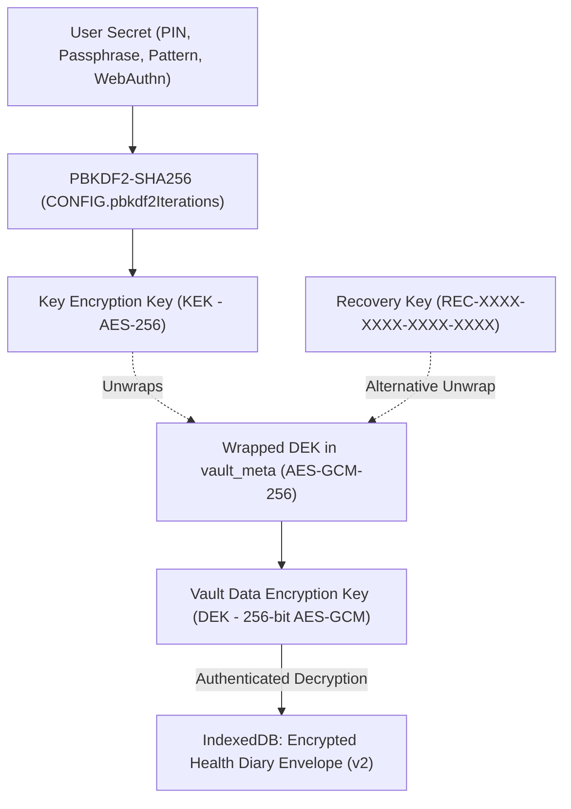

# Saheli 11.0 — Unified Encrypted Vault & Key Hierarchy

## 1. Key Hierarchy Architecture

The Saheli 11.0 Vault separates record encryption from user authentication:



---

## 2. Vault Data Encryption Key (DEK)

- **Algorithm**: `AES-GCM` 256-bit.
- **Generation**: `crypto.subtle.generateKey` on onboarding or migration.
- **In-Memory Residency**: Unwrapped DEK exists only as a reference in `dekRef` while status is `"ready"`.
- **Locking**: Cryptographic lock nullifies `dekRef.current = null` and wipes React state.

---

## 3. Record Envelope Specification (v2)

```typescript
interface EncryptedVaultPayload {
  v: 2;
  alg: "AES-256-GCM";
  iv: string; // 96-bit random nonce (Base64)
  ct: string; // Authenticated ciphertext (Base64)
  ciphertext: string; // Backward compatibility alias
  ts: string; // ISO 8601 generation timestamp
}
```

- **Authentication Tag**: Embedded in GCM ciphertext (last 16 bytes).
- **IV Freshness**: Every write generates a cryptographically secure 96-bit IV via `crypto.getRandomValues`. Nonce reuse probability is $< 2^{-32}$.
