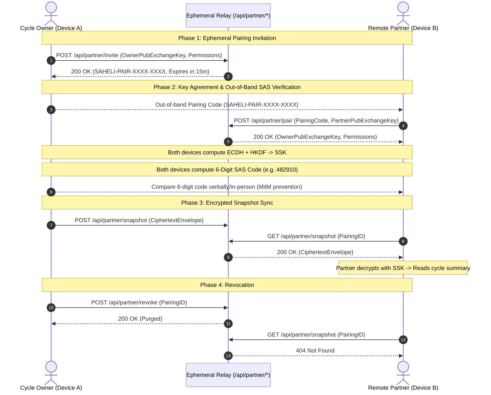

# Saheli 11.0 — Partner Connect Protocol Specification

## 1. Protocol Overview

Saheli Partner Connect is an **optional, read-only, end-to-end encrypted sharing protocol** allowing cycle owners to share designated cycle metrics with a partner's device without granting access to personal diary notes or master credentials.

---

## 2. Four-Phase Handshake

---

## 3. Endpoints Specification

1. `POST /api/partner/invite`:
   - Request: `{ ownerSerialId, ownerExchangePubKey, permissions }`
   - Response: `{ success: true, invitationCode }` (TTL: 15 minutes).
2. `POST /api/partner/pair`:
   - Request: `{ invitationCode, partnerDeviceId, partnerExchangePubKey }`
   - Response: `{ success: true, ownerSerialId, ownerExchangePubKey, permissions }`.
3. `POST /api/partner/snapshot`:
   - Request: `{ ownerSerialId, envelope: { v, alg, iv, ct, ts, permissionsDigest } }`
   - Response: `{ success: true, snapshotId, ts }`.
4. `GET /api/partner/snapshot`:
   - Query: `?ownerSerialId=...` or `?pairingId=...`
   - Response: `{ success: true, envelope: { v, alg, iv, ct, ts } }`.
5. `POST /api/partner/revoke`:
   - Request: `{ ownerSerialId }` or `{ pairingId }`
   - Response: `{ success: true, revoked: true }`.
