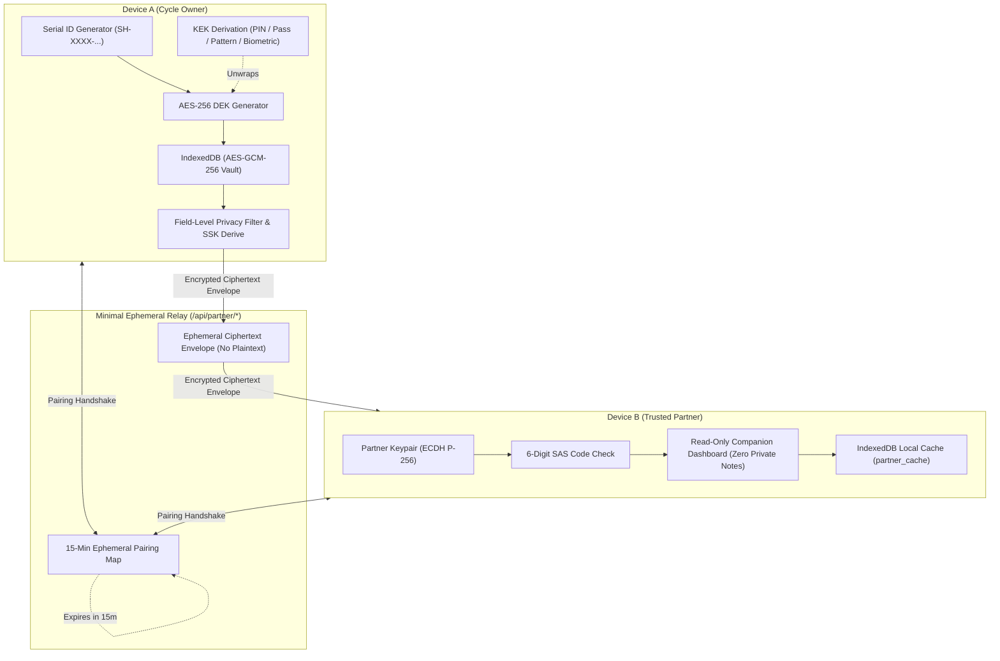

# Saheli 11.0 — Unified Privacy, Security, Identity & Partner Connect Architecture

## 1. Executive Summary

Saheli 11.0 transforms Saheli from a client-side menstrual tracker into an **account-free, cryptographically sovereign personal health ecosystem**. It solves the core tension of shared mobile devices in patriarchal or privacy-compromised environments: ensuring women have unbreakable local diary encryption, zero mandatory accounts, account-free recovery, and the ability to selectively and temporarily share health records with a trusted partner via zero-knowledge end-to-end encryption (E2EE).

---

## 2. Architecture Principles

1. **Zero Registration / Zero Identity Profiling**:
   - No phone numbers, email addresses, names, SMS OTPs, Google, or Apple accounts.
   - Every installation generates a deterministic, 80-bit entropy Crockford Base32 Saheli Serial ID (`SH-XXXX-XXXX-XXXX-XXXX`) protected by a modulo-32 checksum.
2. **Two-Tier Key Hierarchy**:
   - **Vault Data Encryption Key (DEK)**: Randomly generated 256-bit AES-GCM key encrypting diary records, symptom history, and notes.
   - **Key Encryption Keys (KEK)**: Derived via PBKDF2-SHA256 from user unlock secrets (PIN, Passphrase, Pattern, WebAuthn Device Authenticator, or Emergency Recovery Key). Unlocking unwraps the DEK into memory.
3. **Multi-Method Application Locking**:
   - Progressive lockout penalty delays (3s, 15s, 30s, 60s) defending against brute-force attacks.
   - Inactivity auto-lock timer and background visibility lock.
4. **End-to-End Encrypted Partner Connect**:
   - Strictly optional (disabled by default).
   - Zero-knowledge ephemeral relay (`/api/partner/*`): servers only hold ciphertext envelopes.
   - Field-level permissions: private diary notes and AI chats are strictly excluded.
   - Out-of-band 6-digit Short Authentication String (SAS) code prevents Man-in-the-Middle (MitM) attacks.

---

## 3. High-Level System Flow

---

## 4. Key Storage Specifications

| Storage Store      | Key              | Type      | Description                                            |
| :----------------- | :--------------- | :-------- | :----------------------------------------------------- |
| IndexedDB `saheli` | `identity`       | JSON      | Anonymous device identity, Serial ID, public keys      |
| IndexedDB `saheli` | `identity_keys`  | CryptoKey | Non-extractable ECDSA and ECDH private keys            |
| IndexedDB `saheli` | `vault_meta`     | JSON      | Active lock method, KEK wrappers, recovery wrapper     |
| IndexedDB `saheli` | `real` / `demo`  | Envelope  | AES-256-GCM ciphertext payload of user health diary    |
| IndexedDB `saheli` | `partner_state`  | JSON      | Pairing state, sharing keys, approved permissions      |
| IndexedDB `saheli` | `partner_outbox` | Array     | Offline queue for pending ciphertext uploads           |
| IndexedDB `saheli` | `partner_cache`  | Envelope  | Partner-side cached encrypted snapshot for offline use |

---

## 5. Architectural Invariants

- **No Remote Plaintext**: Health information is never transmitted in cleartext under any condition.
- **Immediate Revocation**: Disconnecting a partner wipes all active snapshots from the relay and resets device sharing state.
- **Medical Guardrails Preserved**: Minors under 18 never have fertile window estimates displayed or transmitted to a partner.
- **Multilingual Completeness**: 100% string parity across all 13 supported Indic and regional languages with zero script contamination.
